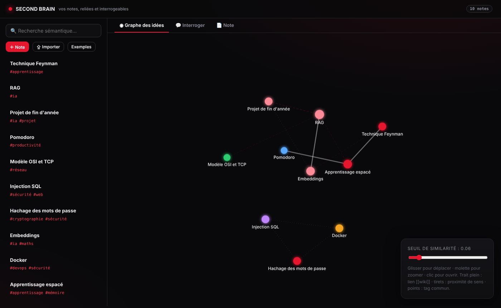
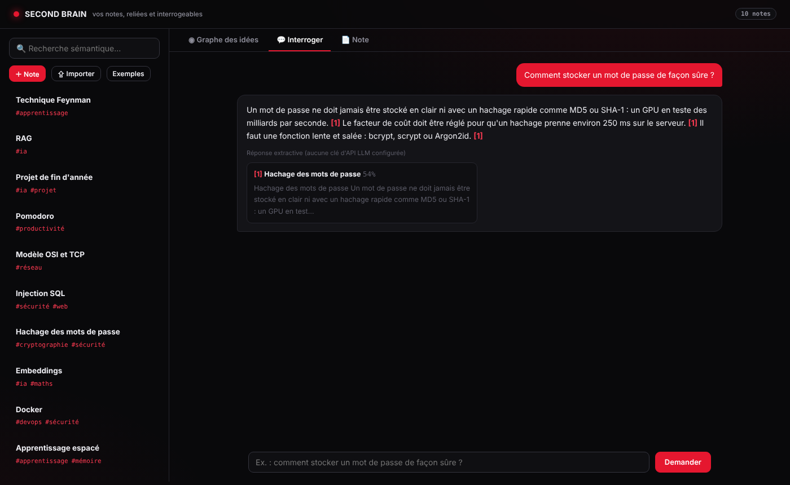

# ◉ Second Brain

> Importez vos notes et vos PDF : les idées se relient automatiquement et vous pouvez interroger vos documents en langage naturel.




## Fonctionnalités
- **Import** de fichiers `.md`, `.txt` et `.pdf` (glisser-déposer multiple) ou écriture directe en Markdown.
- **Graphe des idées** interactif (simulation de forces, zoom, déplacement) qui relie les notes de trois façons :
  - **proximité de sens** (similarité cosinus), avec les termes partagés qui expliquent chaque lien,
  - **liens explicites** `[[Titre de note]]`,
  - **tags communs** `#sécurité`.
- **Recherche sémantique** dans la barre latérale.
- **Questions-réponses (RAG)** : découpage en passages, index vectoriel, récupération des meilleurs passages puis réponse **avec citations cliquables** `[1]`.
  - Sans clé d'API : réponse **extractive** (les phrases les plus pertinentes de vos notes).
  - Avec `ANTHROPIC_API_KEY` ou `OPENAI_API_KEY` : réponse **générée** par un LLM, limitée à vos extraits.
- Page de note : **idées liées**, **rétroliens**, édition.

## Index vectoriel
Chaque passage est vectorisé avec un TF-IDF (racinisation légère FR/EN, unigrammes et bigrammes), complété par une **LSA** (SVD tronquée) qui rapproche les passages partageant des concepts sans partager les mêmes mots. Les vecteurs sont normalisés et la recherche est un produit scalaire (similarité cosinus). L'index est reconstruit à chaque modification : c'est instantané jusqu'à plusieurs milliers de notes.

## Lancer
```bash
pip install -r requirements.txt
python app.py                 # → http://127.0.0.1:5005  (bouton « Exemples » pour 10 notes de démonstration)
python -m pytest -q
```
Variables d'environnement facultatives : `ANTHROPIC_API_KEY`, `OPENAI_API_KEY`, `BRAIN_MODEL`, `BRAIN_DB`.

## Pistes
- Embeddings neuronaux (sentence-transformers) et base vectorielle persistante (FAISS, pgvector)
- Évaluation automatique de la qualité des réponses (jeu de questions de référence)
- Synchronisation avec un coffre Obsidian

## Licence
MIT © Jimo0x
